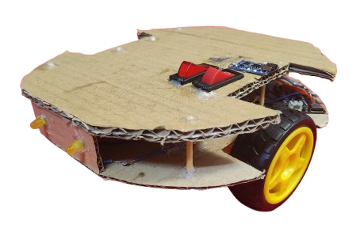
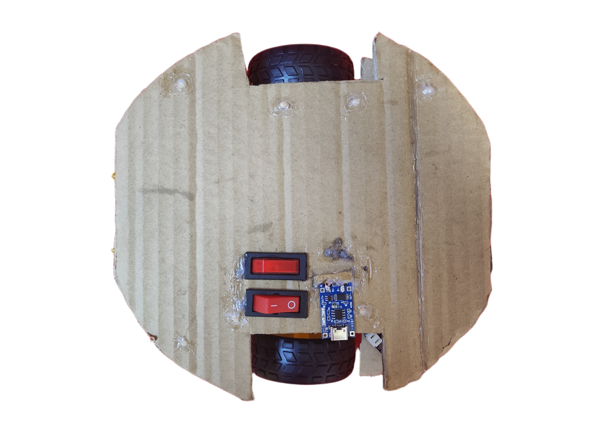

# ESP32 Wi-Fi RC Car 🚗
An ESP32 RC car controlled from a browser over Wi-Fi. Just connect to the car's Wi-Fi network, open the web page, and drive. No apps, no Bluetooth pairing, no Web Bluetooth APIs needed.

Here's the current look of the car:

  
  

## 📡 Connecting via Wi-Fi
The ESP32 creates its own Wi-Fi Access Point (AP). 

✅ **How to connect:**
1. On your phone or laptop, open your Wi-Fi settings.
2. Connect to the network: **`ESP32_RC_Car`**
3. Password: **`rcCar1234`**
4. *Note for mobile users:* Your phone will likely warn you that "This Wi-Fi network has no internet access." You **must** tap **"Keep Connection"** or **"Stay Connected"**, otherwise your phone will silently drop the connection.
5. Open your web browser and go to: **`http://192.168.4.1`** 
   *(you can try writing `http://esp32car.local` on some devices, it might work).*

❌ **Doesn't work:**
*   You cannot use this with mobile data turned on if your phone aggressively switches back to 5G/4G. You must allow the "dumb" Wi-Fi connection to stay active, while you control the car.

---

## 🧰 Components
**Brains**
- `ESP32 WEMOS LOLIN32 Lite` (CH340C chip)
- `TC1508A Dual H-Bridge Motor Driver Module` (sold as ,,`MINI L298N`", but with the TC1508A chip, not an actual L298N)

**Muscles**
- 2x `TT Gearbox DC Motor` (3V–6V, 1:48 gear ratio)
- 2x `5mm Yellow LED`
- 2x `220Ω Resistor` (for the LEDs)
  
**Power/Charging**
- `3.7V 1S Lithium-Polymer Battery` (Original: 802060-1000mAh, died. Replaced with: 103450-2000mAh fake cell "Zombie Cell")
- `TP4056 Lithium Charger Module` (with DW01HA + 8205A protection, USB Type-C)
- `MT3608 DC-DC Boost Converter` (Step-Up, set to output 5V)
- `LM2596 DC-DC Buck Converter` (Step-Down, set to output 3.3V)
- 2x `2-Pin Rocker Switch (SPST)` (one for the charger circuit, one for the main motor+led circuit)

---
**Motors, charger and rest of logic get separate power, but there's one shared ground.**

**Ground (GND):**
Every `-` wire in the car goes to one common junction.

**Pins used:**
| Function | GPIO |
|---|---|
| Motor A | 13, 26 |
| Motor B | 33, 4 |
| LEDs | 18, 23 |

## 💻 Setup
**ESP32 (Arduino IDE):**
1. Board: WEMOS LOLIN32 Lite w/ CH340C chip
2. **Upload speed: 115200** (921600 fails with a scary flash error)
3. Libraries: `WiFi.h`, `WebServer.h`, `ESPmDNS.h`
4. Upload the `.ino` to the board

**Controller:**
*   Connect to the `ESP32_RC_Car` Wi-Fi network.
*   Open `http://192.168.4.1` in any browser (Safari, Chrome, Edge).

## 🎮 Driving
1. Flip Switch 2 (car circuit) ON. Leave Switch 1 (charger) OFF.
2. Connect to the `ESP32_RC_Car` Wi-Fi network.
3. Go to `http://192.168.4.1`.
4. GAS / REVERSE / LEFT (Forward and Backward) / RIGHT (Forward and Backward) / STOP / LIGHTS (Hold the buttons to drive, release to stop).

**To charge:**
1. Flip Switch 2 (car) OFF.
2. Flip Switch 1 (charger) ON.
3. Plug in USB to the TP4056.
4. When done, unplug USB, flip Switch 1 OFF.

## ⚠️ Lessons Learned the Hard Way
- **Don't connect USB and battery at the same time.** Pick one.
- **Set LM2596 to exactly 3.30V** before wiring it to the ESP32. Not 3.5V or anything "close enough."
- **Battery → MT3608 (5V) → LM2596 (3.3V)** because the buck converter can't lower a voltage less than 5V, so we need to first increase the 3.7V to 5V, then reduce it to 3.3V.
- **Don't charge while driving.** TP4056 has no load sharing.
- **The Mobile "No Internet" Prompt:** When connecting to the ESP32's Wi-Fi, iOS and Android will try to switch back to mobile data because there's no internet. You *must* tell the OS to stay connected to the ESP32.
- **Loose wires = Ghost Voltages.** Wrapping wires instead of soldering them creates high resistance that makes chargers and multimeters hallucinate (e.g., reading 4.2V when the battery is at 3.4V - this a specific scenario while charging the battery). So jsut solder everything!
- **PWM Speed Limits Save Batteries.** Running the motors at 50% speed (PWM) drastically reduces the current spike, preventing the battery voltage from sagging below the ESP32's brownout limit, so the whole circuit works perfectly with quite low voltage (that's why the current "zombie cell" actually does the job).
- **Motors without capacitors can work fine.** (add them only if Bluetooth drops out under load)

## 🛠️ Quick Troubleshooting
| Problem | Fix |
|---|---|
| "Flash chip connection" error | Upload speed → 115200 |
| Can't load `192.168.4.1` | Ensure your phone didn't disconnect from the Wi-Fi due to "No Internet", turn off mobile data temporarily. |
| Wi-Fi drops when motors start | Power supply can't handle the current spike, check battery health |
| Won't boot on battery, works on USB | Check common ground, verify 3.30V under load, press RST once and wait 5s |
| Motors twitch and everything dies | Battery sag or DW01 tripping |

## 🪦 Casualties (in the order given)
1. **1x GPIO 27** — Killed during a soldering operation with a bad batch of solder. Moved Motor B over to GPIO 33 instead.
2. **1x 2000mAh LiPo (103450)** — Proved to be a completely fake cell. Charged 0.01V in 10 minutes, tripped its protection circuit constantly, and runs the ESP32 at 2.91V under load. Refuses to charge past 3.48V without the charger hallucinating 4.2V. Yet somehow perfectly fits the
3. **1x TC1508A Motor Driver** — Died suddenly mid-project. Suddenly stopped responding on Motor A, onnly worked for Motor B. Suspect a voltage spike during the LiPo's final death throes. Replaced with an identical unit.
4. **1x 2000mAh LiPo (103450) - THE ZOMBIE CELL** — Proved to be a completely fake cell (seriously discharged during testing and never recovered....would charge to 4.18-4.2V in less than 10 min and drop back to 3.29V the second you unplugged it). Refuses to charge (the TP4056 instantly flashes the blue "full" light even when the cell is at 3.35V-3.348V). However, it also refuses to die. Survived an exhausting **50+ minute (continuous) test run**: driving through school hallways and classrooms, and is still functioning at 3.35V. Will be dead once it drops below 3.2V (its internal protection circuit is tripped in a loop and continously cuts off the charge current, making recharging impossible).

---

## 📜 Status
**Working (with zombie cell...).** Tight turning, stable Wi-Fi connection, smooth acceleration (PWM ramping), and headlights (the two LEDs) toggle. 
Future upgrades: better design, a real 18650 LiPo battery

*A lot more parts died than planned. Soldering was nearly impossible at times. Web Bluetooth was a nightmare and got scrapped entirely for a Wi-Fi AP. The battery turned out to be the biggest nightmare of them all.*

## 🎖️ Credits & Acknowledgments
⭐ **Build, Code, & Suffering:** All done by me. From designing the circuit and wiring to coding the local HTTP web server on the ESP32, implementing the PWM motor logic, and spending 3 days debugging ghost voltages with DeepSeek :).  
⭐ **The "Jerry" Inspiration:** Huge shoutout to my classmates(https://github.com/lukspuks & https://github.com/sarakochovska) who helped brainstorm and came up with the idea for the name **Jerry**, as well as the upcoming mouse-like chassis design.

*Jerry will soon be left in the school projects cabin for future generations of makers to hopefully not destroy.*

---

## 💭 Final thoughts
* **Time it took to complete:** 3 days, 6 hours
* **Conclusion:** Electronics isn't something to toy with. It was pure ragebait 60% of the time🥲.
